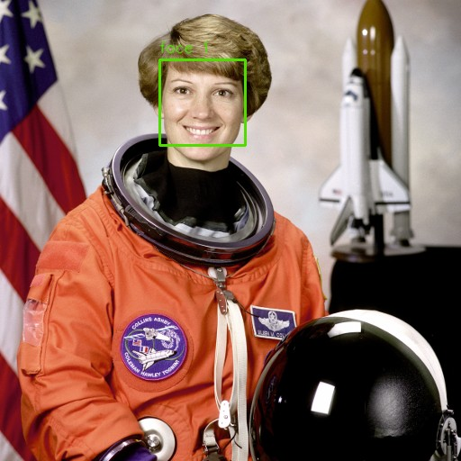

<div align="center">

# Face Detection

**Find faces. Draw bounding boxes. Export coordinates.**

A compact Python library and command-line toolkit for image files and live webcam streams, powered by OpenCV.

[](https://github.com/vivekdatla96/Face_detection/actions/workflows/ci.yml)


[Quick start](#quick-start) · [Commands](#commands) · [Python API](#python-api) · [Development](#development)

</div>

## At a glance

- **Images:** detect faces in one or several files and save annotated copies.
- **Webcam:** preview detections live, with optional mirroring.
- **JSON:** export face counts and pixel coordinates for downstream tools.
- **Self-contained model:** the Haar cascade ships with the package; no model download or API key is needed.

## Detection preview



Actual detector output on NASA's public-domain portrait of astronaut Eileen Collins, distributed by scikit-image. Green boxes mark detected regions. Haar cascades can miss faces or produce false positives; this tool detects face regions, not identities.

## Quick start

Requires **Python 3.10 or newer**. Run these commands in a terminal:

```bash
git clone https://github.com/vivekdatla96/Face_detection.git
cd Face_detection
python -m venv .venv
```

Activate the environment:

```powershell
# Windows PowerShell
.venv\Scripts\Activate.ps1
```

```bash
# macOS / Linux
source .venv/bin/activate
```

Install and try the included sample helper:

```bash
python -m pip install --upgrade pip
python -m pip install .
python scripts/fetch_sample.py
face-detect image assets/sample_face.png --output-dir outputs
```

The last command prints the face count and writes `outputs/sample_face_faces.png`. Input images are preserved. If the `face-detect` command is not on your PATH, use `python -m face_detection` with the same arguments.

## Commands

### Annotate one or more images

```bash
face-detect image photo.jpg group.png --output-dir outputs
```

### Export JSON without saving images

```bash
face-detect image assets/sample_face.png --json --no-save
```

The output is a JSON array, with one entry per successfully read image. Each entry includes `path`, `count`, and `faces`; each face has `x`, `y`, `width`, and `height` in pixels. When saving is enabled, `annotated` contains the output path. Errors go to stderr and the exit code is nonzero if an input fails.

### Live camera preview

```bash
face-detect camera --mirror
face-detect camera --device 1
```

Press **q** to close the preview. A local camera and graphical display are required. Camera frames are processed locally; the command does not record video or upload frames.

### Tune detection

```bash
face-detect image photo.jpg --scale-factor 1.05 --min-neighbors 3 --min-size 40 40
```

- `--scale-factor` (default `1.1`): smaller steps search more scales, usually with more work.
- `--min-neighbors` (default `5`): raise this to reject more weak candidates.
- `--min-size W H` (default `30 30`): ignore candidates smaller than this pixel size.

Use `face-detect image --help` or `face-detect camera --help` for all options.

## Python API

```python
import cv2
from face_detection import FaceDetector
from face_detection.detector import detections_to_dicts

detector = FaceDetector()
image, faces = detector.detect_file("photo.jpg")
annotated = detector.annotate(image, faces)
cv2.imwrite("photo_annotated.jpg", annotated)

print(detections_to_dicts(faces))
```

`detect()` accepts NumPy arrays in BGR, BGRA, or grayscale format. Each returned `Detection` includes `x`, `y`, `width`, `height`, `center`, and `as_tuple`.

## Development

```bash
python -m pip install -e ".[dev]"
python -m pytest -q
```

The real-portrait integration test runs when `assets/sample_face.png` exists; otherwise it is skipped. Download it with `python scripts/fetch_sample.py` before running tests to include that check.

CI runs pytest on Python 3.10–3.14 on Linux and Python 3.12 on Windows. A separate job builds a wheel and source distribution, validates their metadata, and loads the bundled cascade from the installed wheel outside the source tree. Webcam hardware is not exercised in CI.

```text
src/face_detection/     Detector, CLI, and bundled cascade
scripts/fetch_sample.py Sample portrait downloader
tests/                  Unit, CLI, and optional portrait integration tests
docs/images/            Real detection preview for this README
.github/workflows/      Automated tests and packaging checks
```

## Troubleshooting

- **Camera will not open:** check camera permissions, close other camera apps, and try another `--device` index.
- **No preview window:** use a desktop session and install `opencv-python`, rather than `opencv-python-headless`. Avoid installing both variants in the same environment.
- **Few or no detections:** try a well-lit, front-facing portrait. Small, turned, occluded, or blurred faces are difficult for this model.
- **Sample download fails:** use your own local image; detection itself does not require an internet connection.

## Credits

Maintained by **Vivek Datla**. Detection uses OpenCV's frontal-face Haar cascade. The bundled XML retains its upstream license notice. The sample portrait is credited to NASA via scikit-image.
